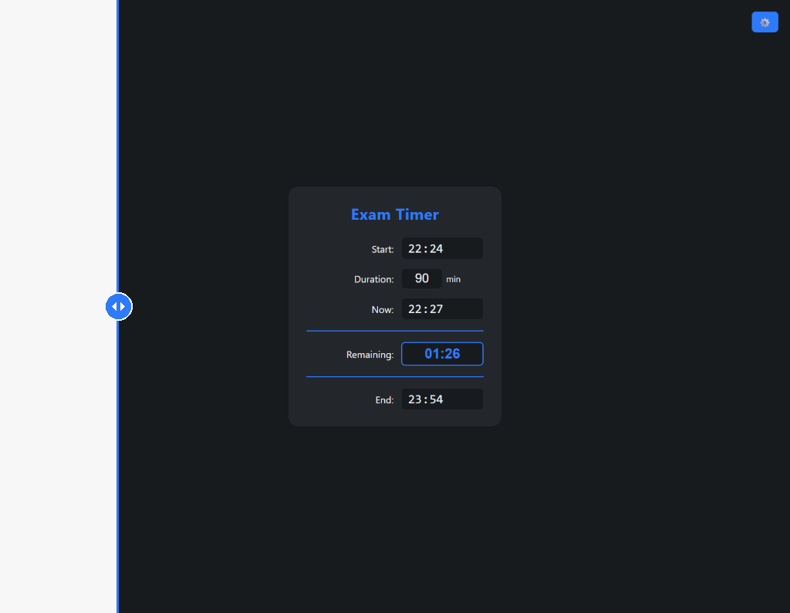

# Exam Timer

<p align="left">
  <a href="https://larsbrockmann.github.io/ExamTimer/"></a>
  
  
  
</p>

Minimalist exam timer with live remaining time, countdown support, and dark mode.

Live demo: [larsbrockmann.github.io/ExamTimer](https://larsbrockmann.github.io/ExamTimer/)

<p align="center">
  
</p>

## Development

```bash
npm install
npm run dev      # Start dev server (http://localhost:3001)
npm run build    # Production build
npm run lint     # Run ESLint
```

## Modes

- **Start + Duration**: Calculates end time and shows live remaining time based on current clock.
- **Countdown**: Simple minute countdown timer with start and stop controls.

## Settings

Click the ⚙️ icon to toggle:
- Dark mode
- Seconds display (auto-activates during the final minute)
- Active timing mode
